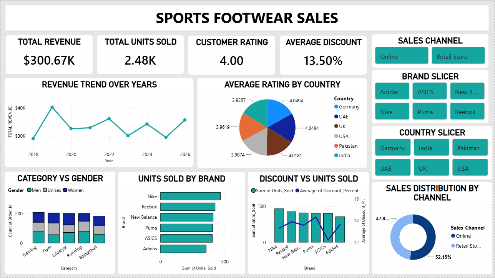

# Sports Footwear Sales Analysis | Power BI

## Project Overview
This project uses Microsoft Power BI to explore sports footwear sales performance across brands, countries, product categories, and sales channels.

## Dashboard Preview

## Key Metrics
- **Total Revenue:** $300.67K
- **Total Units Sold:** 2.48K
- **Average Customer Rating:** 4.00
- **Average Discount:** 13.50%

*These values reflect the current report and should be validated against the underlying dataset.*

## Tools Used
- Power BI Desktop
- Power Query
- DAX
- Git and GitHub

## Analysis
- Revenue trends over time
- Units sold by brand
- Sales distribution by channel
- Customer ratings by country
- Category and gender comparisons
- Discount and sales-volume comparisons

## Skills Demonstrated
- Data visualization
- KPI reporting
- Data transformation
- Interactive dashboard development
- Business data analysis

## Files

| File | Description |
|---|---|
| Sports_Footwear_Sales.pbix | Power BI project file containing the interactive dashboard and data analysis |
| Sports_Footwear_Dashboard.png | Dashboard preview image |
| README.md | Project documentation |

## Author

**Asmi Nazar**

Aspiring Data Analyst
